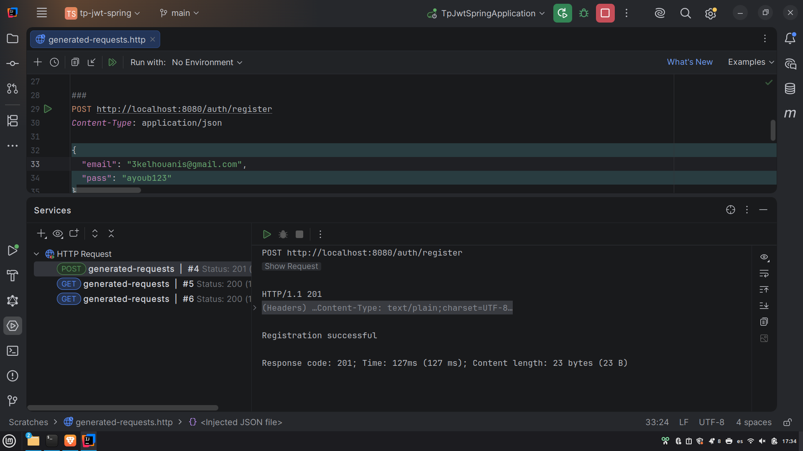
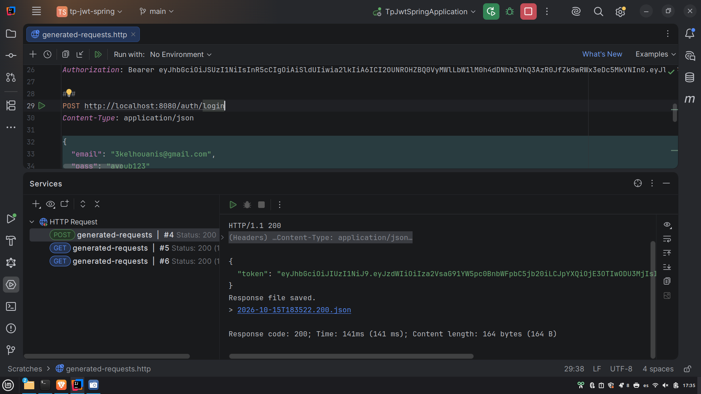
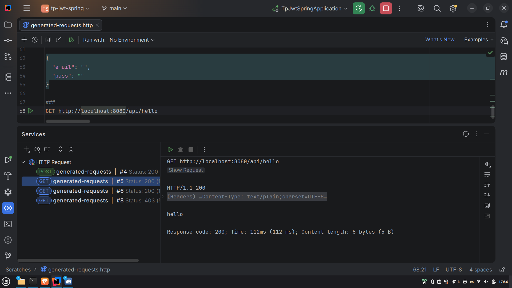
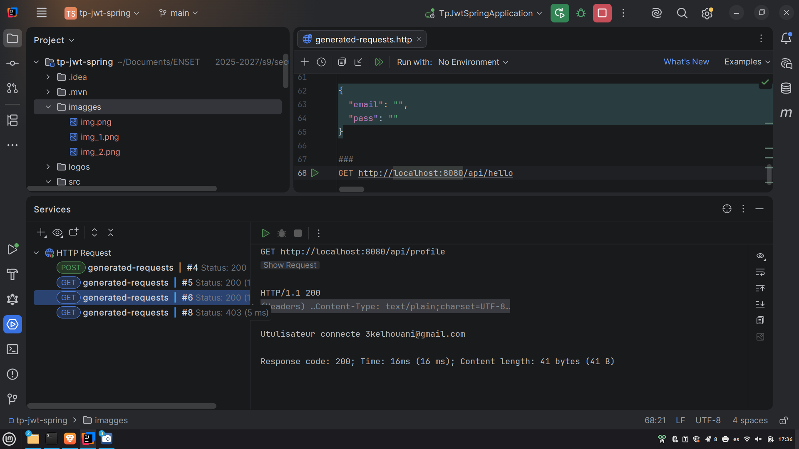
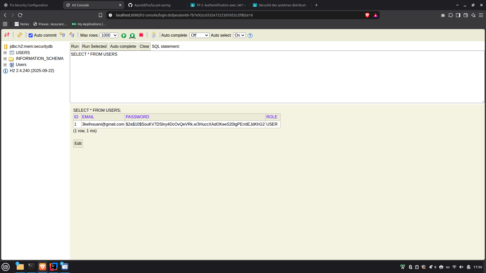

# TP JWT Spring

Ce projet est une API REST Spring Boot sécurisée avec des JSON Web Tokens (JWT). Il permet l'inscription des utilisateurs, la connexion, le hachage des mots de passe avec BCrypt et l'accès à des endpoints protégés.

## Technologies utilisées

- Java 21
- Spring Boot 4.1.1
- Spring Security
- JSON Web Token with JJWT
- Spring Data JPA
- Base de données H2 en mémoire
- Maven

## Fonctionnalités principales

- Inscrire un nouvel utilisateur avec `POST /auth/register`.
- Authentifier un utilisateur avec `POST /auth/login` et recevoir un JWT.
- Protéger les endpoints de l'API avec un token `Bearer`.
- Enregistrer les utilisateurs dans une base de données H2 en mémoire.
- Accéder à la console H2 pendant le développement.

## Exécution du projet

Vérifiez que Java 21 est installé, puis démarrez l'application avec Maven :

```bash
./mvnw spring-boot:run
```

Sous Windows, utilisez :

```bat
mvnw.cmd spring-boot:run
```

L'API est disponible à l'adresse `http://localhost:8080`.

## Exemples d'utilisation de l'API

### Inscription d'un utilisateur

```http
POST http://localhost:8080/auth/register
Content-Type: application/json

{
  "email": "user@example.com",
  "pass": "password123"
}
```

Le mot de passe est haché avec BCrypt avant d'être enregistré dans la base de données.

### Connexion

```http
POST http://localhost:8080/auth/login
Content-Type: application/json

{
  "email": "user@example.com",
  "pass": "password123"
}
```

La réponse contient un token JWT :

```json
{
  "token": "<jwt-token>"
}
```

### Appel d'un endpoint protégé

Ajoutez le token retourné par la connexion dans l'en-tête `Authorization` :

```http
GET http://localhost:8080/api/profile
Authorization: Bearer <jwt-token>
```

Endpoints disponibles :

| Méthode | Endpoint | Authentification |
| --- | --- | --- |
| `POST` | `/auth/register` | Non requise |
| `POST` | `/auth/login` | Non requise |
| `GET` | `/api/hello` | JWT requis |
| `GET` | `/api/profile` | JWT requis |

## Console H2

La console H2 est disponible à l'adresse `http://localhost:8080/h2-console`.

Utilisez les paramètres de connexion suivants :

- URL JDBC : `jdbc:h2:mem:securitydb`
- Nom d'utilisateur : `sa`
- Mot de passe : laisser vide

La base de données est en mémoire : ses données sont donc supprimées lorsque l'application est arrêtée.

## Fonctionnement de la sécurité JWT

1. Un utilisateur s'inscrit avec une adresse e-mail et un mot de passe.
2. Le mot de passe est haché puis enregistré dans la base H2.
3. L'utilisateur se connecte avec les mêmes identifiants.
4. L'application retourne un JWT signé.
5. Le filtre JWT valide le token lors des requêtes vers les endpoints protégés.

## Captures d'écran

Les captures d'écran sont enregistrées dans le dossier existant `imagges/`.

### Inscription d'un utilisateur

Cette image montre une requête `POST /auth/register` contenant une adresse e-mail et un mot de passe. Le serveur retourne `201 Created` et confirme que l'utilisateur a été inscrit avec succès.



### Connexion et réponse JWT

Cette image montre une requête `POST /auth/login`. Après validation des identifiants, le serveur retourne `200 OK` avec un token JWT utilisable pour accéder aux endpoints protégés.



### Requête vers l'API publique

Cette image montre une requête réussie vers `GET /api/hello`. La réponse est `hello`, ce qui confirme que l'endpoint est accessible via l'API.



### Requête vers le profil protégé

Cette image montre une requête vers `GET /api/profile` utilisant le JWT dans l'en-tête `Authorization`. Le serveur valide le token et retourne l'adresse e-mail de l'utilisateur authentifié.



### Console de la base de données H2

Cette image montre la console H2 affichant la table `USERS`. Elle confirme que l'utilisateur inscrit est enregistré avec un mot de passe haché et le rôle `USER`.



